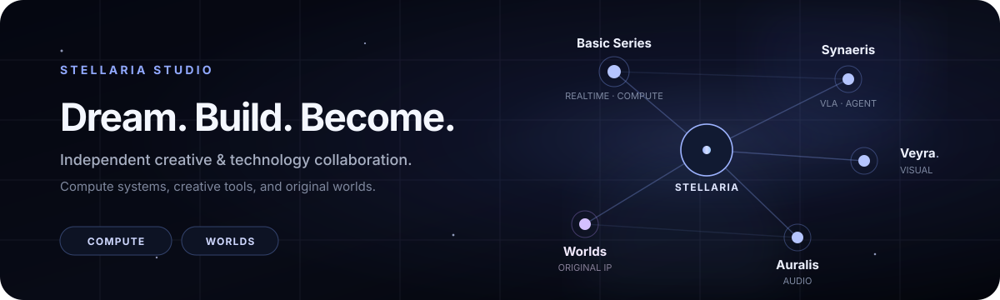

<p align="center">
  
</p>

<p align="center">
  <strong>让技术与创作自然相连。</strong><br/>
  Independent creative &amp; technology collaboration for compute systems, creative tools, and original worlds.
</p>

<p align="center">
  <a href="https://stellaria-studio.com/">Website</a>
  &nbsp;·&nbsp;
  <a href="https://stellaria-studio.com/compute.html">Compute</a>
  &nbsp;·&nbsp;
  <a href="https://stellaria-studio.com/worlds.html">Worlds</a>
  &nbsp;·&nbsp;
  <a href="https://stellaria-studio.com/devlog.html">Devlog</a>
  &nbsp;·&nbsp;
  <a href="https://stellaria-studio.com/license.html">License</a>
</p>

---

## Stellaria Studio

Stellaria Studio is an independent creative & technology collaboration building **graphics and compute infrastructure, AI systems, modern production tools, and original content**.

We are intentionally a small team. Instead of spreading across many disconnected projects, we try to build a few reusable foundations deeply enough that research, engineering, products, and actual creative production can reinforce one another.

Stellaria Studio currently operates as an independent collaboration rather than a registered company.

### Two directions

| Stellaria Compute | Stellaria Worlds |
| --- | --- |
| Graphics computing, high-performance training & inference, AI systems, realtime engines, and creator-facing production tools. | Original IP, stories, illustration, music, voice, animation, video, and the production workflows around them. |
| [Explore Compute →](https://stellaria-studio.com/compute.html) | [Explore Worlds →](https://stellaria-studio.com/worlds.html) |

**Worlds is not a demo appendix for Compute.** It is where the tools meet real creative work. The constraints found in production flow back into Compute as engineering requirements, benchmarks, and research questions.

---

## Stellaria Compute

Four primary lines share one evolving compute foundation.

| Line | Direction |
| --- | --- |
| **[Basic Series](https://stellaria-studio.com/products/basic-series.html)** | Realtime creation and unified compute. Basic is the compute-first realtime engine and editor/runtime; BasicX, SPX and StSL provide reusable compute, operator, precision and GPU-language layers. |
| **[Synaeris](https://stellaria-studio.com/products/synaeris.html)** | Our most research-intensive line: a local edge VLA / agent system connecting observation, memory, world modelling and action for long-horizon interactive tasks under constrained hardware. |
| **[Veyra](https://stellaria-studio.com/products/veyra.html)** | The next visual generation and production line, inheriting ArtXpert research and moving toward fast single-step generation, specialized-content generation, controllable editing and reusable production workflows. |
| **[Auralis](https://stellaria-studio.com/products/auralis.html)** | A BasicX-powered unified high-performance audio workstation. Auralis One is the current product direction: bringing realtime and offline voice, singing, TTS / SVC, model and asset workflows into one coherent experience with less duplicated runtime and storage. |

### Basic Series

Basic Series is the shared systems layer rather than a collection of isolated tools.

- **Basic** — a compute-first realtime engine, editor and runtime for modern interactive graphics and creator workflows.
- **BasicX** — the unified compute platform for heterogeneous execution, scheduling, inference, training and multi-task workloads.
- **SPX** — the operator, kernel and precision layer, including Stellaria precision profiles and device-qualified execution paths.
- **StSL** — Stellaria's GPU shading / compute language and compiler toolchain.

BasicX, SPX and StSL are designed to be reused across product lines rather than duplicated inside each application.

---

## From compute to creation

```text
Research · models · kernels · systems
                  ↓
              Basic Series
      Basic · BasicX · SPX · StSL
                  ↓
      Synaeris · Veyra · Auralis
                  ↓
      real products & creative work
                  ↓
           Stellaria Worlds
                  ↓
 feedback · constraints · benchmarks
                  ↺
```

This loop is central to how Stellaria is built: infrastructure should be exercised by real products, and products should generate concrete pressure for better infrastructure.

---

## Our principle

> 技术进步不应以取代创作者为目标，组织发展也不应建立在封闭、打压与恶性竞争之上。

We want technology to **expand what creators can do**, not make creators the thing to be removed. We prefer sustainable development, open collaboration, clear technical boundaries, and giving capable people more room to build.

Even when a system becomes competitive, the goal is not to win by closing the door behind it.

---

## Public development

A significant part of Stellaria Compute is still under active **private development** while interfaces, release boundaries, licensing, and long-term maintenance are being stabilized.

Public repositories therefore represent only the currently released slice of Stellaria Studio. We publish selected code, experiments, specifications, research artifacts and releases when they are ready to be maintained as public work.

For the current project map and progress, start with the **[official website](https://stellaria-studio.com/)** and **[Devlog](https://stellaria-studio.com/devlog.html)**.

---

<p align="center">
  <strong>Dream. Build. Become.</strong><br/>
  <sub>Stellaria Studio</sub>
</p>
